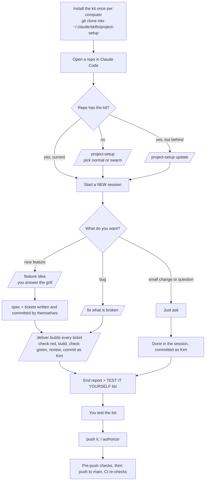

# project-setup kit

Kim's Claude Code toolkit. One command gives a repo the whole way of working: Matt Pocock's grill, spec, tickets and test-first build; Lauren Tan's "proven on the real app" finish; Addy Osmani's guards (fresh-eyes doubt review, docs-checked framework code, floor guard against silenced checks). It works for any stack: TypeScript, Rust, Python and Go are detected by themselves, and anything else is named once in `.claude/kit.json`.

Kim is the only author on GitHub, there are no pull requests, and nothing is pushed without "I authorize".

> **Layout (v6).** A short `SKILL.md` (the steps), `files/kit/` (every kit file, copied exactly by `tools/install.mjs`), `files/merge/` (settings, CI and Playwright files merged with the repo's own), `templates/` (CLAUDE.md, health.md), `docs/update-notes.md` (clean-up for older kits) and `VERSION`. Installed by cloning this repo. Versions up to v5.3 were one long `SKILL.md` saved to the Claude account.

---

## The whole flow at a glance



---

## 1. Install the kit (once per computer)

### Option A: clone from GitHub (recommended)

The full folder (`SKILL.md`, `files/`, `docs/`) arrives exactly as tested.

**Mac**
```bash
git clone https://github.com/kimmatthewg20-Hobby/project-setup-kit ~/.claude/skills/project-setup
```

**Windows (PowerShell)**
```powershell
git clone https://github.com/kimmatthewg20-Hobby/project-setup-kit "$env:USERPROFILE\.claude\skills\project-setup"
```

The repo is private, so the clone uses your GitHub login on that computer (the same one your other repos use).

Then, in any repo, type `/project-setup check`. If it answers, the install works.

**After it works:** delete the old account copy in claude.ai Settings → Skills (`project-setup`). Otherwise two versions exist (`/project-setup` and `/anthropic-skills:project-setup`) and drift apart.

### Option B: zip upload to your Claude account (optional, cloud only)

Only if you ever want to run setup inside a cloud session. Download the repo as a zip (GitHub → Code → Download ZIP) and upload it in claude.ai Settings → Skills. Not needed for normal use: every repo already carries its own kit, so cloud sessions can `/feature`, `/fix` and `/deliver` without it. A zip copy does not update itself; re-upload it for each new kit version. Test once that the extra folders arrive before relying on it.

### Option C: nothing (cloud sessions)

Cloud sessions need no install. They clone your repo, and the repo holds the kit.

---

## 2. Keep the kit up to date

### The kit itself: automatic

Every `/project-setup` run starts by pulling this repo (`git pull --ff-only` in `~/.claude/skills/project-setup`). If `SKILL.md` changed, it re-reads it before doing anything. Offline or the pull fails: one line says so, and it continues on the version it has. It never merges or overwrites a hand-edited copy; it stops and tells you instead.

By hand, any time:
```bash
git -C ~/.claude/skills/project-setup pull
```

### Each repo: you choose when

A repo records its kit version in `.claude/kit.json`. When a session starts in a repo whose kit is older than the installed one, you see one line, for example: `Kit v6.0 here, v6.1 installed: run /project-setup update.` Nothing changes until you run it, so hooks and the guard never change in the middle of a `/deliver` run.

```text
/project-setup update            update this repo, keep its build mode
/project-setup update swarm      update and switch to swarm mode
/project-setup update normal     update and switch to normal mode
```

Update replaces the kit files with the installed version, refreshes Matt Pocock's skills (`npx skills update`, then re-applies the model settings), adds anything new (for example `.githooks/` in a Rust repo, the Rust CI job), and lists what it changed. Commit it as usual; push with "I authorize".

---

## 3. Set up a repo

Open the repo in Claude Code on your Mac and type one of:

| Command | What it does |
|---|---|
| `/project-setup` | Setup; asks once: normal or swarm |
| `/project-setup normal` | Setup, one ticket at a time (lighter on usage, recommended) |
| `/project-setup swarm` | Setup, up to 5 workers at once in their own worktrees (faster, uses plan usage up to 5× faster; drops to normal by itself when usage runs low) |
| `/project-setup check` | Read-only health check of this repo's kit |
| `/project-setup help` | The kit guide, checked against this repo |
| `/project-setup cloud-env` | Prints the environment block to paste into a cloud environment |

### What setup does

1. **Scan** (read-only): every stack (package.json, Cargo.toml or `src-tauri/`, pyproject, go.mod), what kind of app it is (web, CLI, desktop, library), existing scripts, old kits.
2. **Baseline:** runs your current checks. Anything red goes on the Debt list and is skipped in the hooks until green; it is never hidden.
3. **Identity:** you confirm the name and email every commit will carry.
4. **A few questions** (at most 5, one at a time): what the app is for, the stack if it cannot tell, sensitive data, words to use, anything Claude must never touch.
5. **Copies the kit files** exactly from `files/`: hooks, guard, scripts, sub-skills, CI, settings.
6. **Checks list:** `node scripts/check.mjs --list` shows what this repo runs. Anything missing is written into `.claude/kit.json` `checks`. A repo with nothing to check fails instead of passing.
7. **Proves the hooks:** 330+ hook tests must pass.
8. **Git hooks:** Husky in JS/TS repos, a plain `.githooks/` folder everywhere else.
9. **End-to-end checks** by app type: Playwright for web screens; a `tests/cli.rs` that runs the real binary for a Rust CLI; Playwright for a Tauri app's web part (the native window goes on your test list).
10. **One commit** as you. **Never pushed.**

Then: **start a new session** (agents, hooks and the status line load at session start).

### New repo vs existing repo

- **New repo:** create it (private), `git init`, open it in Claude Code, `/project-setup`. The default web stack is Next.js, TypeScript strict, Supabase, Tailwind with shadcn/ui, Zod and Vercel, unless you say otherwise (for Rust it asks: CLI, web server, Tauri desktop or library).
- **Existing repo:** commit or stash your own changes first, then `/project-setup`. Your CLAUDE.md content, learned rules and notes are kept.
- **Repo with an older kit:** `/project-setup update`. It also cleans up older layouts and the old `/ship` name.

### Cloud sessions (optional, once per repo)

`/project-setup cloud-env` prints a block for the cloud environment's variables (your git identity, dev database values, a fake test account; you type the secret values yourself, never in chat). Setup step 17 lists the network domains to allow (Playwright, crates.io, and so on). Start each cloud session on branch `main` with that environment. Only pushed work reaches the cloud.

---

## 4. Daily work

### A new feature

```text
/feature export the beneficiary list to CSV
```

1. **Grill:** Claude asks you questions until the feature is clear. This is the only part that needs you.
2. **Spec and tickets** are written in `.scratch/<feature>/` and committed by themselves. Big features get `/wayfinder` first.
3. **`/deliver`** starts by itself and runs every ticket:
   - writes the ticket's check first and runs it **red**;
   - builds it on the model the task needs (Sonnet low up to Fable);
   - runs the same check **green**, then all fast checks;
   - drives the real app (`verify-<app>`) for anything a user touches;
   - reviews it, plus a fresh-eyes **doubt review** on risky tickets;
   - **commits as you**.
4. **End report:** what was built, anything blocked, new dependencies, and a short **TEST IT YOURSELF** list.

### A bug

```text
/fix the CSV export drops names with commas
```

It finds the root cause, writes a test that fails because of the bug, fixes it through `/deliver`, and commits as you. The same bug twice becomes a check that fails the build.

### Small things

Just ask: "rename the button", "why is this slow", "where is X used". The router picks the right model for each request.

### Other commands

| Command | Use |
|---|---|
| `/deliver .scratch/<feature>/` | Build (or resume) a feature's open tickets; add `swarm` or `normal` to override once |
| `/report` | One page: what shipped, what is blocked, how the debt moved |
| `/webperf` | Speed audit with honest numbers only |
| `/improve-codebase-architecture` | Find deeper refactors |
| `/reflect` | After a hard session: lessons become checks |
| `/wait-what` | A reply did not land |

> Type **`/deliver`**, never `/ship`. Claude Code's built-in `/ship` pushes and opens a pull request.

### Finish: test and push

1. You test the **TEST IT YOURSELF** list.
2. Say **`push it, I authorize`** (in a cloud session: `ship it, I authorize`, which rebases onto `main` first).
3. The pre-push hook runs every check, then pushes. CI re-checks on GitHub. Pushing `main` deploys where Vercel is connected.

---

## 5. Words that unlock things

| You say | What it allows | For how long |
|---|---|---|
| `I authorize` | One push (never a force push), or edits to protected kit files | 30 minutes, this session only |
| `/project-setup ...` | Kit files and git identity during setup or update | 2 hours, this session only |
| `go anyway` | Work while a second Claude session is open on the same folder | This session |
| `Floor-exception: <rule> <path> - <reason>` (in a commit message) | One silenced check that is right on purpose | That commit |

---

## 6. What runs by itself

| When | What |
|---|---|
| Every `/project-setup` run | Pulls the latest kit from GitHub |
| Every session start | Sets you as git author; turns `.githooks/` on; warns about a second session; says if this repo's kit is behind; in the cloud, installs packages, crates and the Playwright browser |
| Every command Claude runs | The guard: blocks force push, deploys, publishing, live database, PRs, secrets, protected files |
| Every commit | Format, lint, typecheck or tests for the stack, secret scan, learned checks, author check (AI lines stripped), floor guard |
| Every push | Push gate ("I authorize", every commit yours), then all checks |
| Every push on GitHub | CI per stack, end-to-end tests, `npm audit` or `cargo audit`, author check |

---

## 7. When something goes wrong

| You see | Do |
|---|---|
| `check: no format, lint, typecheck or test step found` | Run `node scripts/check.mjs --list`; name the commands in `.claude/kit.json` `checks` (or run `/project-setup update`) |
| A floor-guard refusal | Fix the code; if it is right on purpose, add a `Floor-exception:` line to the commit message |
| `BLOCKED by project guard` | Read the reason; a wrong block is a kit bug, report it, never work around it |
| `Kit v… here, v… installed` | `/project-setup update` in that repo |
| The kit pull failed | Check your GitHub login; `git -C ~/.claude/skills/project-setup pull` by hand |
| Session lock warning | Close the other Claude session on this folder, or say `go anyway` |
| Anything else | `/project-setup help` or `/project-setup check` |

---

## 8. Releasing a new kit version (maintainer)

1. Change `SKILL.md`, `files/` or `docs/` in this repo.
2. Run the tests in a throwaway git repo: `node <kit>/tools/install.mjs .`, then `node .claude/tools/test-hooks.mjs` (all must pass) and `node scripts/check.mjs --list`; repeat in a fake Rust repo and a fake TypeScript repo.
3. Bump `VERSION` (and the title in `SKILL.md`), add a section to `docs/update-notes.md` if old repos need clean-up, commit as Kim, tag `vX.Y`.
4. Push with "I authorize". Every computer picks it up on its next `/project-setup` run; each repo updates when you run `update` there.

## Versions

| Version | What changed |
|---|---|
| v5.2 | Doubt review, floor guard, `/fix`, `/report`, `/webperf`, session lock, usage guard |
| v5.3 | Any stack (Rust, Python, Go), `/ship` renamed `/deliver`, CI fix |
| v6.0 | Split layout: short `SKILL.md` + exact `files/`, install by clone, self-updating, repo version notice |
